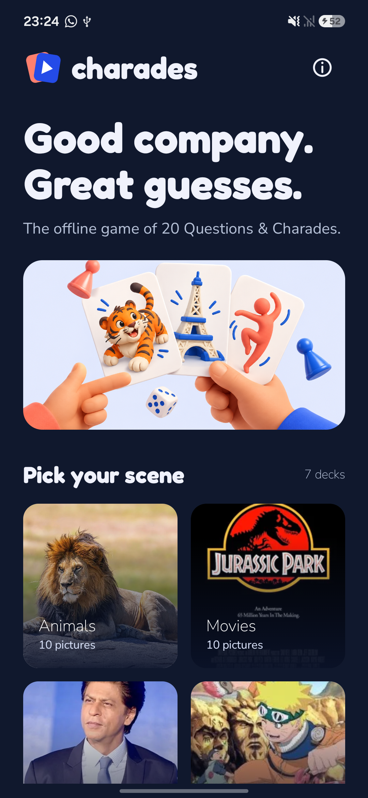
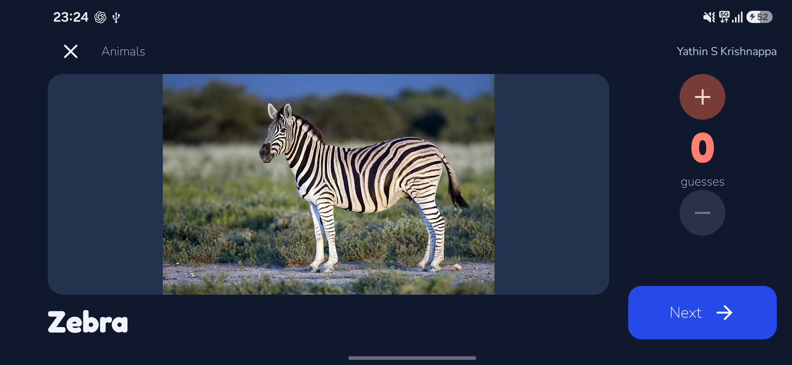

# Charades

**The offline game of 20 Questions & Charades.**

A free Android game for friends and family. All sections, clues, and images ship inside the app: one download, one installation, then play offline.

## How to install

Requires **Android 8.0 or newer**. Install the complete APK once. All seven current sections and their photos are included, with no content setup after installation.

### Build and install with ADB

1. Install Android Studio. In SDK Manager, install **Android SDK Platform 35** and **Android SDK Platform-Tools**. Use **JDK 17 or 21** for Gradle 8.9, and set `JAVA_HOME` if needed. Newer Android Studio versions may bundle a newer JDK, so select 17 or 21 explicitly.
2. Open this repository in Android Studio and let Gradle sync, or set `sdk.dir` in your own untracked `local.properties`.
3. Enable **Developer options → USB debugging** on the phone, connect it by USB, and accept its debugging prompt.
4. Run from the repository root in PowerShell:

```powershell
.\gradlew.bat assembleDebug
& "$env:LOCALAPPDATA\Android\Sdk\platform-tools\adb.exe" devices
& "$env:LOCALAPPDATA\Android\Sdk\platform-tools\adb.exe" install -r .\app\build\outputs\apk\debug\app-debug.apk
```

Use your actual SDK path. With multiple connected devices, add `-s DEVICE_SERIAL` immediately after `adb.exe`.

For a single command that validates, builds, installs, and launches the complete app:

```powershell
.\scripts\install.ps1
# With multiple devices: .\scripts\install.ps1 -Serial DEVICE_SERIAL
```

The APK is `app/build/outputs/apk/debug/app-debug.apk`. You can also copy it to a phone, open it, and allow installation from the app used to open the file. The APK includes all sections and images; no separate photo push or database download is needed.

On macOS/Linux, use `./gradlew assembleDebug` and `adb install -r app/build/outputs/apk/debug/app-debug.apk`. Developers need internet for initial SDK/Gradle setup; players do not need it after installation.

## In the app





## How to play

Choose **Animals, Movies, Famous People, Animes, Anime Characters, Countries, or Household Objects**. Open a section and start. The phone switches to landscape, counts down for three seconds, and reveals the image and word.

- **20 Questions:** the player who cannot see the screen asks yes/no questions. Use + and − to track guesses manually.
- **Charades:** act out the clue for the other players, using your group's rules.

The count never goes below zero. **Next** resets it and starts the next reveal countdown. **X** or system Back returns to the previous screen. The section shuffles when you enter its detail screen, then keeps that order during the session.

No timed rounds, scores, sounds, or account setup. The interface stays dark. Countdown timing continues if the phone locks; an active clue keeps the screen awake until three minutes without interaction.

## Development

Kotlin, Jetpack Compose, Material 3, and a bundled JSON catalog. No server, runtime updater, Room database, analytics, or advertising.

```powershell
python scripts\validate_catalog.py
python scripts\sync_policies.py --check
.\gradlew.bat testDebugUnitTest lintDebug assembleDebug
```

- [Product context](PRODUCT.md) and [agent instructions](AGENTS.md).
- [Architecture](docs/ARCHITECTURE.md), [development/testing](docs/DEVELOPMENT.md), and [content guide](docs/CONTENT.md).
- [Decisions](docs/DECISIONS.md) and [spec reconciliation](docs/SPEC_RECONCILIATION.md).
- [Design direction](DESIGN.md) and [interaction contract](UX-CONTRACT.md).

## Privacy, terms, and support

No runtime permissions, network access, accounts, saved profiles, analytics, ads, or in-app payments. Session state stays on the device.

Read the [privacy policy](docs/PRIVACY_POLICY.md) and [terms](docs/TERMS_OF_SERVICE.md), also included in the app. Source code is under [GNU GPL v3](LICENSE). Image provenance is in [the source manifest](docs/photo_sources.json).

No donation URL or beneficiary has been supplied. Any future donation action must use a configured external browser link and remain optional.

Report bugs through [GitHub Issues](https://github.com/JunaidAhamed-7777/Charades/issues).
